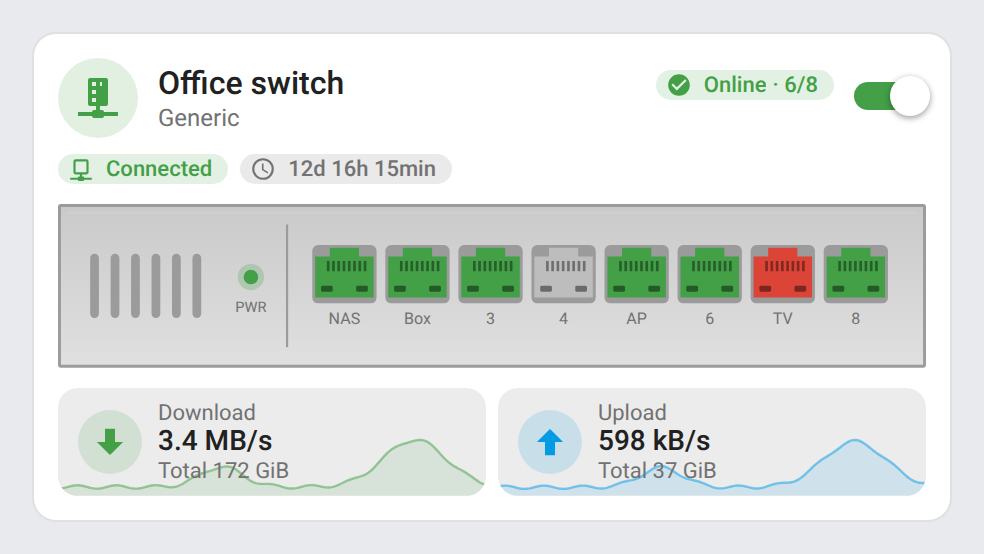
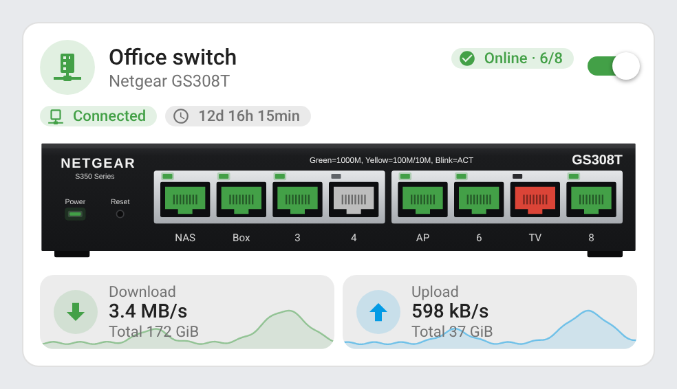
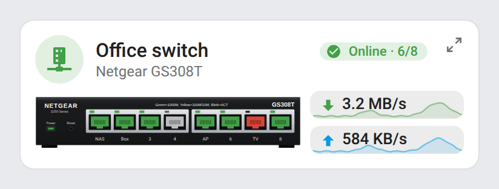
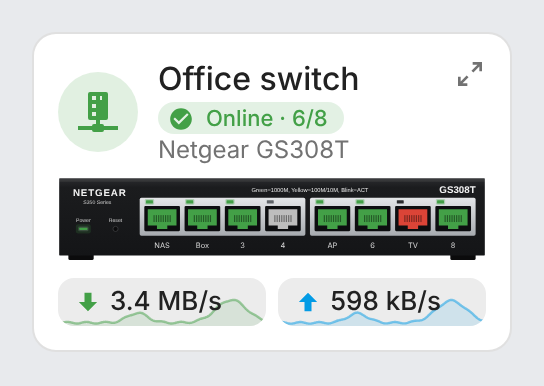
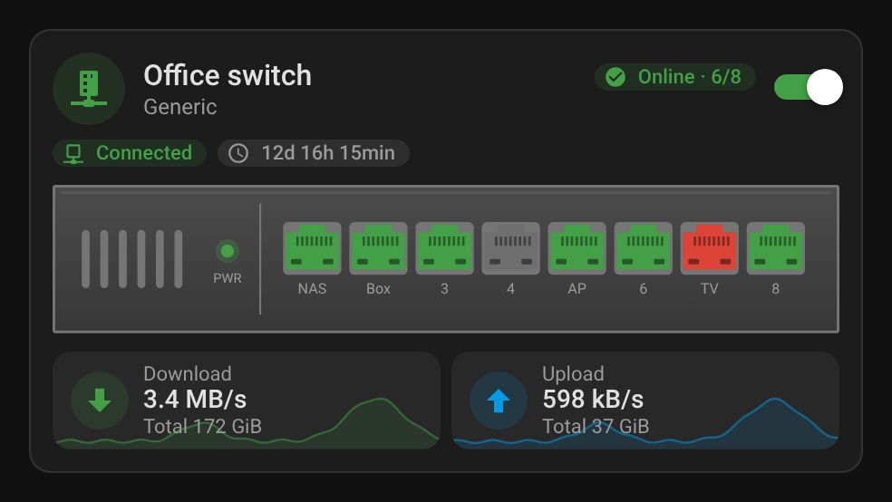
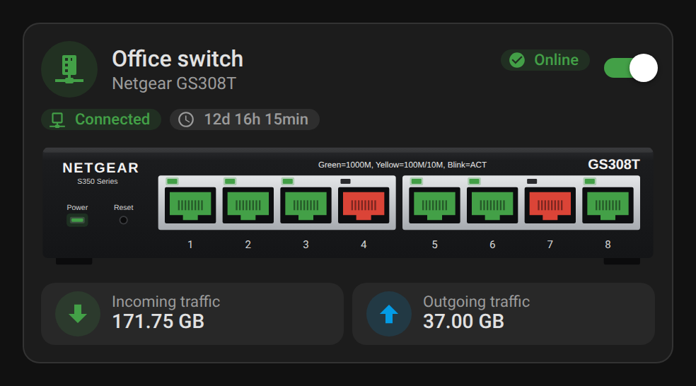
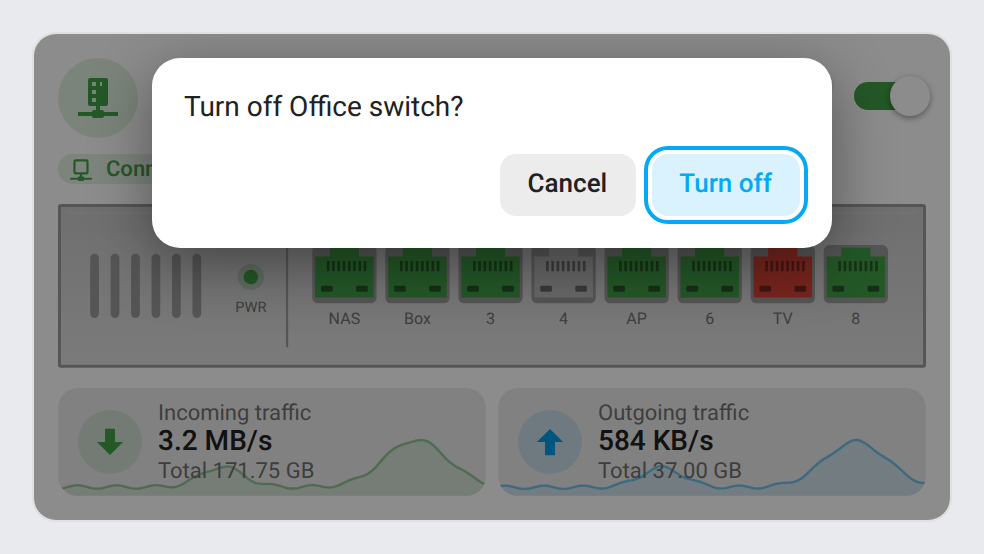
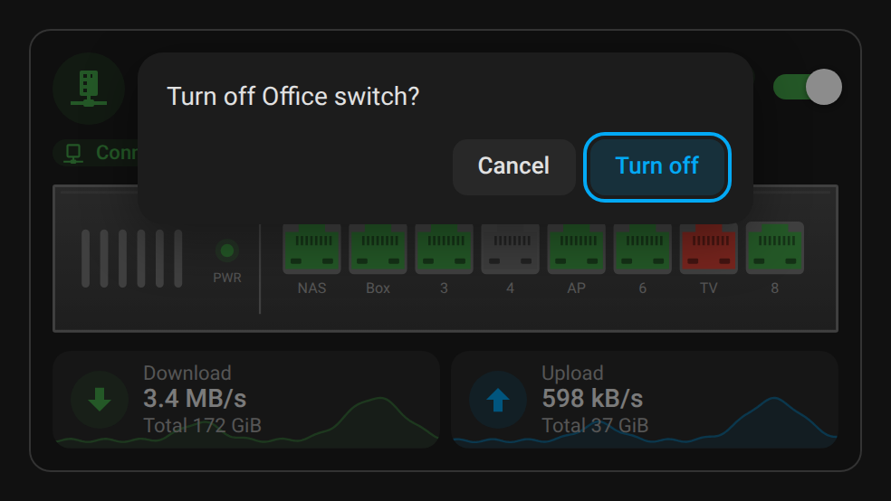
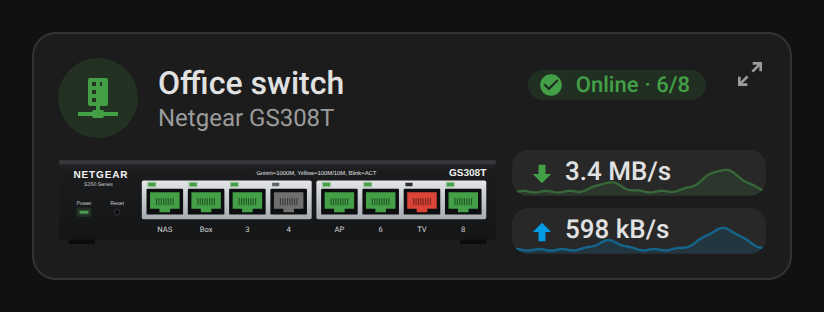
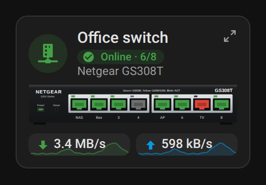

# ha-switch-card

[](https://www.home-assistant.io/integrations/marketplace/)
[](https://github.com/juju35/ha-switch-card/actions/workflows/hacs.yml)
[](https://github.com/juju35/ha-switch-card/actions/workflows/validate.yml)
[](https://github.com/juju35/ha-switch-card/actions/workflows/lint.yml)
[](https://github.com/juju35/ha-switch-card/releases/latest)
[](https://github.com/juju35/ha-switch-card/blob/main/LICENSE)
[](https://buymeacoffee.com/julienstep9)

<p align="center"></p>

<p align="center">
  
</p>

Custom Lovelace card for Home Assistant displaying a managed network switch (SNMP): power toggle, global status, connectivity, uptime, per-port state and traffic. Pure JavaScript, no dependencies (no mushroom, card-mod or button-card required). Fully configurable from the visual editor. English, French, German, Spanish, Serbian (Cyrillic and Latin), Italian, Dutch, European Portuguese, Polish, Romanian, Danish, Swedish, Bulgarian, Russian, Ukrainian, Hungarian, Slovak, Czech, Slovenian, Latvian and Greek, auto-detected from Home Assistant or set with `language`.

[](https://my.home-assistant.io/redirect/marketplace_repository/?owner=juju35&repository=ha-switch-card&category=plugin)

| Generic front panel | Netgear GS308T (drawn front panel) |
|---|---|
|  |  |

| Mini card | Mini card on a phone |
|---|---|
|  |  |

## Features

- Header with a status-colored icon, name, subtitle and power toggle; turning the switch off asks for a confirmation first (it can cut the network Home Assistant runs on)
- Chips for connectivity, global status and uptime (SNMP timeticks, seconds, or a boot-time timestamp sensor)
- Two cards: `ha-switch-card` and its mini version `ha-switch-mini-card` (front panel and rates side by side; a detail button shows the full card)
- Live state of every port on the device; tap a port to open its entity
- Port names under the drawn ports and in their tooltips; a port without link is grey (nothing plugged in), red only when it is one of the watched ports
- Ports up out of all next to the status (*Online · 6/8*)
- Download / upload rate computed from the byte counters (`kB/s`, `MB/s`), with the total under it (`GiB`), and the last 24 hours drawn behind (recorder statistics, on a real time axis, broken where data is missing)
- Built-in devices: a drawn generic front panel (1–52 ports) that follows the light or dark theme, or a drawn Netgear GS308T (S350) front panel with its ports and link LEDs
- Custom image support with an adjustable port overlay
- Status colors from the Home Assistant theme
- Visual editor in the dashboard UI (no YAML needed), in every supported language
- Single file, no dependencies (no mushroom, card-mod or button-card)

## Supported integrations

| Integration | What the card reads |
|---|---|
|  [SNMP](https://www.home-assistant.io/integrations/snmp/) (built in, YAML) | One sensor per port with its operational status, plus optional status, connectivity, uptime (timeticks) and traffic sensors |

Any other integration works as long as its port entities follow a pattern (`port_pattern`, with `{n}` for the port number); status, connectivity, uptime (seconds), traffic and power switch entities are optional.

## Prerequisites

Home Assistant 2024.8 or later, and:

Entities describing your switch, usually from the [SNMP integration](https://www.home-assistant.io/integrations/snmp/): one sensor per port with its operational status (`1` = up), plus optional status, connectivity, uptime and traffic sensors and a power switch. Every entity is optional; the card shows what is configured.

## Installation

### Via the Marketplace (recommended)

Click the button below to add the repository directly:

[](https://my.home-assistant.io/redirect/marketplace_repository/?owner=juju35&repository=ha-switch-card&category=plugin)

Then click **Install**, and reload your browser when the Marketplace asks you to.

Or manually:

1. Open **Settings → Marketplace → Add from link** (top right; this needs a GitHub account connected)
2. Add `https://github.com/juju35/ha-switch-card` — Type: **Dashboard**
3. Open **Network Switch Card** and click **Install**
4. Clear your browser cache and refresh

### Manual

1. Download `ha-switch-card.js` and the `ha-switch-card.i18n.*.js` translation files from the [latest release](https://github.com/juju35/ha-switch-card/releases/latest).
2. Copy them all to `/config/www/` (without the translation files, the cards show in English).
3. Go to **Settings → Dashboards → ⋮ → Resources** and add `/local/ha-switch-card.js` as a **JavaScript module**, or in YAML mode:

   ```yaml
   lovelace:
     resources:
       - url: /local/ha-switch-card.js
         type: module
   ```

4. Reload your browser.

## Configuration

### Visual editor

Edit a dashboard, click **Add card** and search for **Network switch card**. Every option below is available in the editor, grouped by entities, ports, status and appearance.

### Full options

```yaml
type: custom:ha-switch-card
name: Living room switch Netgear S350 (GS308T)
subtitle: 8 monitored ports
icon: mdi:switch
switch_entity: switch.living_room_switch
status_entity: sensor.living_room_switch_global_status
connectivity_entity: binary_sensor.living_room_switch
uptime_entity: sensor.living_room_switch_uptime
traffic_in_entity: sensor.living_room_switch_port_1_in
traffic_out_entity: sensor.living_room_switch_port_1_out
ports: 8
port_pattern: sensor.living_room_switch_port_{n}_status
model: gs308t
url: http://switch.local
```

### Options reference

| Option | Default | Description |
|---|---|---|
| `name` | `Switch` | Title |
| `show_title` | `true` | Show the title in the header (e.g. `false` under a section heading of your own) |
| `subtitle` | – | Subtitle |
| `icon` | `mdi:switch` | Header icon, colored by status |
| `switch_entity` | – | Power toggle (`switch` / `input_boolean`) |
| `confirm_off` | `true` | Ask for a confirmation (at the top of the card) before turning the switch off: cutting its power can cut the network Home Assistant runs on. Turning it on is immediate. `false` turns it off at once |
| `status_entity` | – | Global status sensor |
| `connectivity_entity` | – | Connectivity `binary_sensor` |
| `uptime_entity` | – | Uptime sensor |
| `uptime_unit` | `timeticks` | `timeticks` (SNMP, 1/100 s) or `seconds`; ignored for a timestamp sensor (boot time), shown as the time since then |
| `traffic_in_entity` / `traffic_out_entity` | – | Traffic sensors. A byte counter (`B`, `kB`, `MB`, `GB`…, e.g. SNMP `ifHCInOctets`) shows its rate, computed from its last two states (or its last 5-minute statistics until then), with its total under it; a sensor already in a rate unit (`kB/s`, `Mbit/s`…) is shown as Home Assistant formats it |
| `show_history` | `true` | 24 h curve behind each traffic rate, from the recorder's 5-minute statistics (the sensor needs a `state_class`: `total_increasing` for a counter) |
| `ports` | `8` | Number of ports |
| `port_names` | – | Names of the ports, in port order (`[NAS, Box, '', AP]`, an empty name keeps the number) or as a map (`{1: NAS, 5: AP}`): shown under the drawn port (7 characters, the rest in its tooltip). The visual editor edits them as the list, and saves a map as that list |
| `watched_ports` | – | Ports whose loss of link is an alarm: red when down. Any other port without link is grey (nothing plugged in) |
| `port_pattern` | `sensor.switch_port_{n}_status` | Port entity pattern, `{n}` = port number |
| `port_on_state` | `1` | State meaning "port up" |
| `online_state` / `idle_state` | `Online` or `En ligne` / `Idle` or `Inactif` | Values of `status_entity` shown green / orange (`unavailable`, `unknown` or a missing sensor → grey, anything else → red), compared case-insensitively. Unset, both the English and French values match; set them to the state your status sensor reports otherwise, e.g. `up` / `standby`. The status pill then reads Online / Idle in the card language (English, French, German, Spanish, Serbian, Italian, Dutch, Portuguese, Polish, Romanian, Danish, Swedish, Bulgarian, Russian, Ukrainian, Hungarian, Slovak, Czech, Slovenian, Latvian or Greek: the `language` option, or the Home Assistant language when unset) |
| `model` | `generic` | Embedded device image: `generic` (drawn front panel, any port count, up to 52) or `gs308t` (drawn Netgear GS308T / S350 front panel: 8 ports in two groups of four, link LED lit when the port is up) |
| `image` | – | Custom device image URL, overrides `model` |
| `port_start` / `port_step` / `port_bottom` | `21` / `10` / `39` | Port overlay position on a custom `image` (%) |
| `url` | – | Opened when tapping the device |
| `zoom` | `true` | Mini card only: detail button at the top right that switches to the full card and back (a click outside the card brings the compact view back) |
| `language` | Auto | Force language: `en`, `fr`, `de`, `es`, `sr`, `sr-Latn`, `it`, `nl`, `pt`, `pl`, `ro`, `da`, `sv`, `bg`, `ru`, `uk`, `hu`, `sk`, `cs`, `sl`, `lv` or `el` (auto-detects from HA settings; `pt-BR` uses `pt`) |

Tapping any chip, tile or port opens its more-info dialog.

## Screenshots

| | Light | Dark |
|---|---|---|
| Generic front panel |  |  |
| Netgear GS308T |  |  |
| Power-off confirmation |  |  |
| Mini card |  |  |
| Mini card on a phone |  |  |

## How it works

Ports are read from `port_pattern` with `{n}` replaced by the port number, and drawn green when their state equals `port_on_state`. A port without link is grey (nothing plugged in), or red when it is one of the `watched_ports`; a missing, `unavailable` or `unknown` entity is grey too (so a failed SNMP poll does not show every port as down).

The mini card shows the header (status and ports up, no power toggle), the front panel and the two rates beside it. On a card 330 px wide or less (a phone, 6 columns of a section) the panel takes the whole width and the rates go under it side by side, one per line under 200 px, where the status pill keeps only the port count (its colour and icon still tell the status, its tooltip has the whole text). Drawn front panels have square corners (1 px); a custom `image` keeps its rounded frame. The header icon and the power LED follow `status_entity` (`online_state` green, `idle_state` orange, `unavailable` / `unknown` or missing grey, anything else red), or `connectivity_entity` when no status is set (`on` green, `unavailable` / `unknown` grey, otherwise red).

As in the other juju35 cards, the status pill sits on the right of the header, on the title's line (left of the power toggle): it shows `status_entity`, or `connectivity_entity` when no status is set. The other chips (connectivity when a status is set, uptime) are shown under the header. On a narrow card the name gives way to the pill down to a few characters; past that the pill moves under the name with its whole text, and is only shortened with an ellipsis when even that line is too short (the full text stays in the tooltip). In the Sections view the card is at least 8 columns wide.

The generic front panel is an SVG drawn by the card: up to 12 ports on one row, beyond that odd ports on top and even ports below, like real switches. Its body is derived from the theme's card and text colors, so it stays readable in light and dark mode.

## Development

```bash
npm install
npm run build        # stamps the version of package.json into dist/ha-switch-card.js
npm run check        # builds and checks the card (run in CI)
npm run screenshots  # renders the card with mock entities into screenshots/ (a file is only rewritten when its pixels change)
```

`dist/` is not committed: `npm run build` creates it locally, CI builds it on every push, and the release workflow attaches the built file to the release, which is where the Marketplace installs it from.

### Releasing

1. Bump `version` in `package.json`
2. Add a `## <version>` section at the top of [CHANGELOG.md](https://github.com/juju35/ha-switch-card/blob/main/CHANGELOG.md)
3. Push to `main`: the **Release** workflow builds the card, creates the tag and the GitHub release with the changelog section as notes, and attaches `ha-switch-card.js`

## Translations

The card auto-detects the language from your Home Assistant settings; set `language` to force one. Currently supported:

| Language | Code |
|---|---|
| English | `en` |
| Français | `fr` |
| Deutsch | `de` |
| Español | `es` |
| Српски | `sr` |
| Srpski (latinica) | `sr-Latn` |
| Italiano | `it` |
| Nederlands | `nl` |
| Português (Portugal) | `pt` |
| Polski | `pl` |
| Română | `ro` |
| Dansk | `da` |
| Svenska | `sv` |
| Български | `bg` |
| Русский | `ru` |
| Українська | `uk` |
| Magyar | `hu` |
| Slovenčina | `sk` |
| Čeština | `cs` |
| Slovenščina | `sl` |
| Latviešu | `lv` |
| Ελληνικά | `el` |

Contributions for additional languages are welcome!

## License

[MIT](https://github.com/juju35/ha-switch-card/blob/main/LICENSE)

## Support

If you find this project useful, you can support its development:

<a href="https://buymeacoffee.com/julienstep9"></a>
